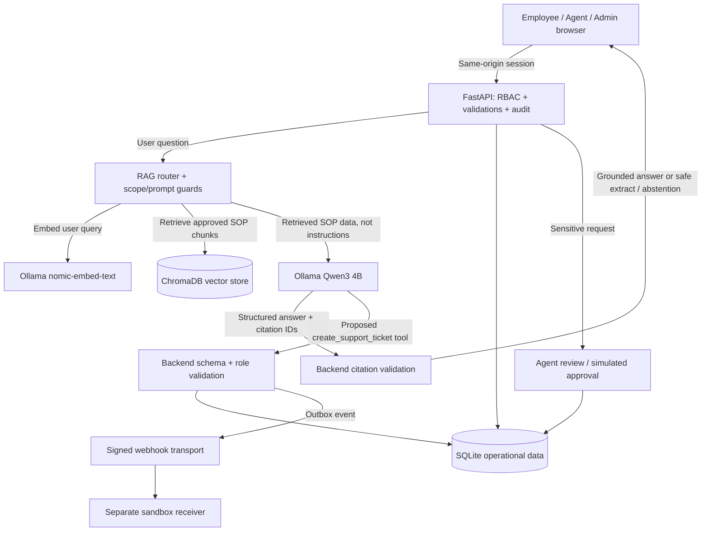

# AI-HAS v12 — Architecture, boundaries, workflows and recovery

## Context and scope

AI-HAS is a bounded **single-assistant** L1 helpdesk, **not** a multi-agent enterprise provisioning engine. The state machines, durable ticket records and tool validation are deterministic application logic. It supports a local free Ollama model or optional OpenAI API; semantic embeddings stored in ChromaDB; SQLite ticket data; independently signed webhook notifications; and a human agent queue.

## Trust boundaries

- **Client/untrusted user:** user input is data, never authority; backend authenticates on every protected route.
- **Knowledge-base text/untrusted source:** admin-uploaded SOP is data. Prompt instructions do not override backend authorization.
- **Model/untrusted proposed action:** no direct SQL, shell commands, or privileged API access; backend checks schema, permissible action, secrets, and idempotency.
- **Sensitive approval:** human agent with role check and request digest verifies state; no real password reset or software provisioning occurs. This prototype does not implement signed supervisor tokens from the Week 14 procurement blueprint.
- **External webhook:** minimal event payload signed via shared HMAC; receiver verifies signature, timestamp and replay key. Logs are maintained for delivery attempts.

## Ticket workflow

`REQUEST → VALIDATE → (CREATE | RETURN EXISTING) → PERSIST → OUTBOX PENDING → (SIGNED DELIVERY | RETRY UP TO LIMIT | FAILED)`.

After creation: `OPEN → IN_PROGRESS/ESCALATED → RESOLVED`; invalid state transitions return HTTP 409. Resolved tickets may be reopened to `OPEN`; transition history is recorded. Tool outcome is reported as created only after the database commit.

## Controlled access workflow

`REQUEST → VALIDATED → PENDING_AGENT_APPROVAL → APPROVED_SIMULATION / DENIED / EXPIRED`.

No actual provisioning is executed. Backend enforces required details, secrets prohibition, role separation, request digest, 24-hour expiry, and single-decision processing. Stale or altered approvals cannot advance; client-side approve buttons are not the authorization boundary.

## Failure and recovery matrix

| Failure | Controlled response | Persistence/verification |
|---|---|---|
| No relevant SOP | Abstain and offer ticket escalation | `outcome=escalation_recommended` |
| Ollama citation invalid | One bounded structured retry; a precisely supported SOP extract; otherwise abstain | `mode` distinguishes actual model answer from fallback |
| Ollama unreachable / Chroma unavailable | Strict semantic mode fails closed; demo fallback only when explicitly configured | Verifier reports FAIL/BLOCKED, never forged PASS |
| Duplicate ticket request | Same request key and payload returns existing ticket; conflicting payload rejects | Unique `(user_id, request_key)` |
| Webhook timeout or receiver unavailable | Persist outbox state and retry with bounded attempts | Audit + admin outbox ledger |
| Approval expired/altered | Block approval; require new request | Stored expiry and digest |
| Authz / CSRF violations | HTTP 401/403; no mutation | Backend route guard |
| Host restart | SQLite survives restart; pending outbox worker can drain retry queue | Real HTTP restart test |

## Why no production claim?

`AIHAS_ENV` intentionally blocks modes other than `demo`. The academic app uses local accounts, a local SQLite database, and a loopback HTTP server. Public internet deployment would require a real identity provider, HTTPS termination, secrets and backup management, disaster recovery, independent security review and production monitoring.
