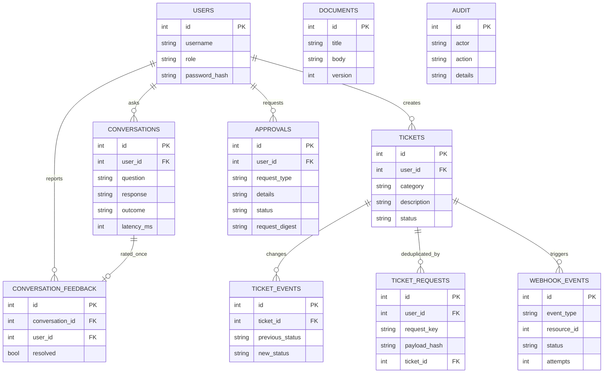

# AI-HAS v12 — Database relationships and API specification

## Operational database vs vector database

- **SQLite (`aihas.db`)**: transactional accounts, tickets, conversations, feedback, approvals, audit and delivery events; local academic prototype persistence.
- **ChromaDB (`chroma` path)**: embeddings/chunks for semantic SOP retrieval; generated from currently stored SOP documents, not the authority for ticket records.
- **Ollama (`localhost:11434`)**: model inference and embeddings, not a durable source of ticket state.

## ERD (simplified)

## Main API routes (full machine-readable spec in `API_OpenAPI_v12.json`)

| Verb | Route | Role | Purpose |
|---|---|---|---|
| POST | `/api/login` | anonymous | Session login, throttled |
| POST | `/api/chat` | authenticated | RAG or model-proposed ticket creation; returns `conversation_id`, mode, citations, outcome |
| POST | `/api/conversations/{id}/feedback` | owner only | One Yes/No resolution outcome for answered chat |
| POST | `/api/tickets` | authenticated | Ticket create; optional Idempotency-Key |
| GET | `/api/tickets` | authenticated | Owner-visible or staff queue |
| PATCH | `/api/tickets/{id}` | staff | Controlled state transition |
| GET | `/api/tickets/{id}/history` | owner/staff | Ticket timeline |
| POST | `/api/escalations` | authenticated | Human helpdesk escalation |
| POST | `/api/approvals` | authenticated | Simulated privileged action request |
| POST | `/api/approvals/{id}/decision` | staff | Simulated approval/denial only |
| GET/POST/PUT/DELETE | `/api/documents*` | read=authenticated; mutate=admin | SOP listing, ingestion, revisions |
| GET | `/api/metrics` | staff | Operational counts and self-reported feedback |
| GET | `/api/audit` | admin | Audit trail |
| GET/POST | `/api/outbox*` | admin | Delivery records, bounded retry |
| GET | `/api/health` | public localhost | Health/status (not provider health certification) |

## Data integrity

- DB commits are transactional; explicit rollback on exceptions; foreign keys enabled.
- Ticket replay key uniqueness and payload digest prevent repeated created tickets.
- SOP optimistic version check prevents stale updates overwriting newer content.
- One feedback record per conversation enforced by unique relationship.
- Request approval compares a digest and expiry, but is NOT a cryptographically signed approval token.
- Staff actions and tool outcomes are audited; minimum-information event payloads delivered by webhook.

## Limitations

SQLite is appropriate for a small demonstration but is not a production HA database. There is no enterprise-managed IAM, row-level multitenant isolation, at-rest encryption guarantee, or production secrets vault.
